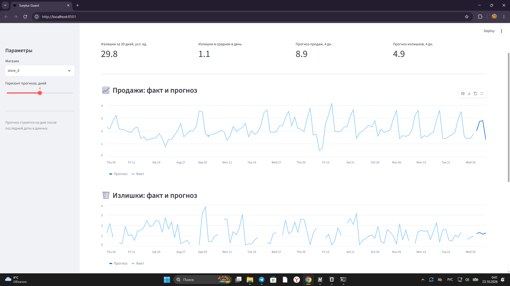
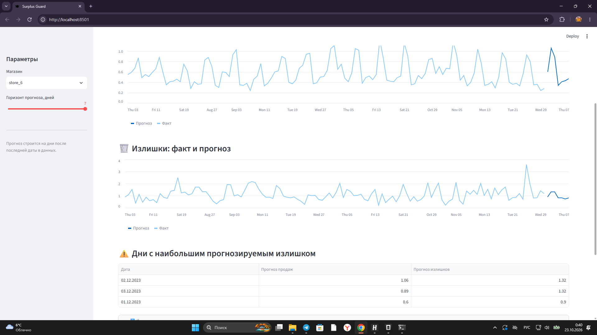
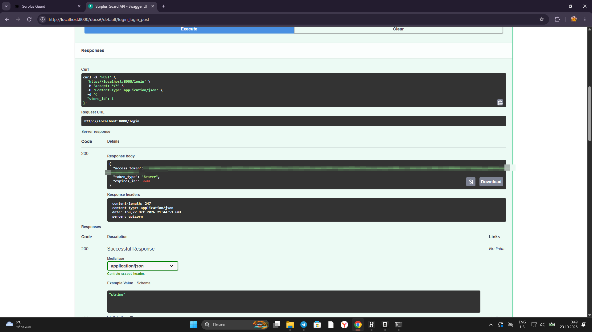
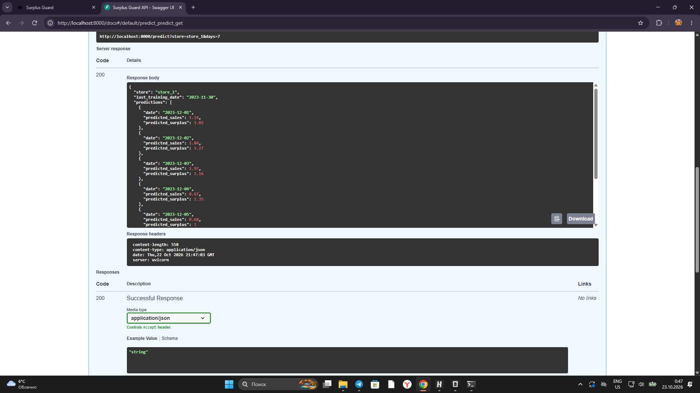
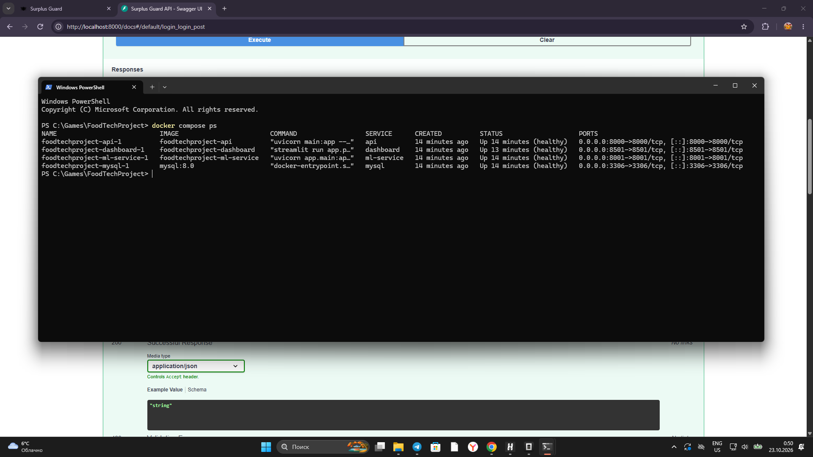
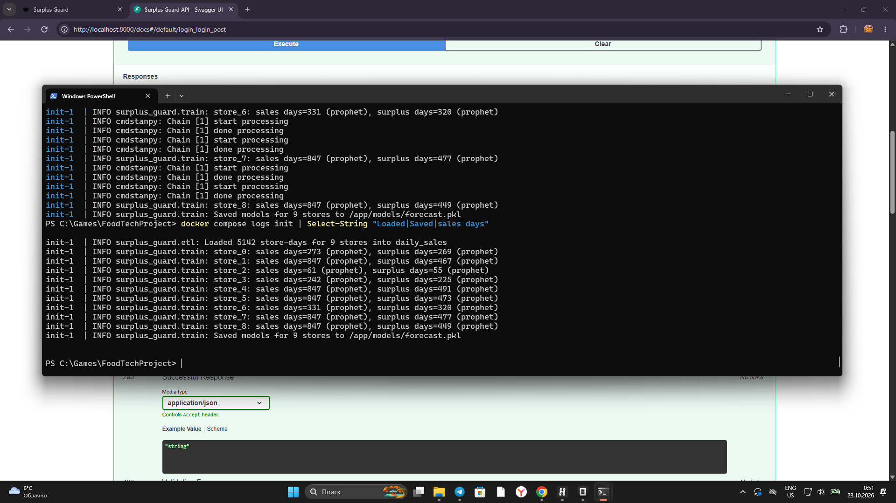
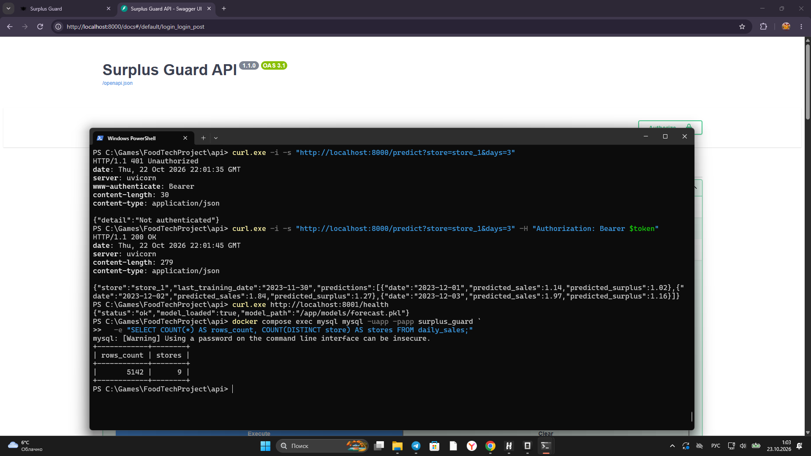
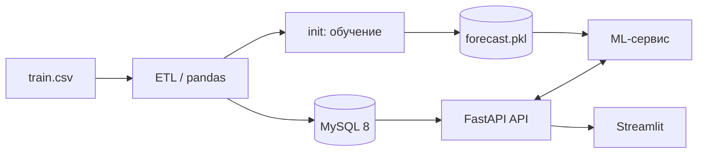

# 🍽 Surplus Guard

**Сервис прогнозирования спроса и излишков еды для фудтех-сети**


Сквозной MVP: **ETL → MySQL → ML → FastAPI → Streamlit**.
Помогает планировать производство на 7 дней вперёд, снижать пищевые отходы и даёт основу
для ESG-метрик («спасённая еда»).

<p align="center">
  
</p>
<p align="center">
  <i>Дашборд: KPI, факт и прогноз продаж и излишков. Магазин <code>store_8</code>, горизонт 4 дня.</i>
</p>

## Что умеет

- 📈 Строит прогноз продаж и излишков на 1–7 дней для каждого магазина.
- ⚠️ Показывает топ-3 дня с наибольшим риском излишков.
- 📊 Считает статистику излишков и продаж за период.
- 🔐 Защищает API через JWT (`/login` → Bearer-токен).
- 🐳 Полностью контейнеризован: MySQL, API, ML-сервис и дашборд в Docker Compose.
- 🛟 Работает даже без Prophet — автоматически переключается на fallback-модель.
- 🧪 Покрыт pytest-тестами API и ML-сервиса.

## Скриншоты

### 📊 Дашборд: графики и таблица рисков

<p align="center">
  
</p>
<p align="center">
  <i>Нижняя часть дашборда: излишки «факт + прогноз» и дни с наибольшим прогнозируемым излишком.</i>
</p>

### 🔐 API: получение JWT

<p align="center">
  
</p>
<p align="center">
  <i><code>POST /login</code> возвращает <code>access_token</code>, <code>token_type</code> и <code>expires_in</code>.
  Токен на скриншоте скрыт.</i>
</p>

### 📈 API: прогноз через Swagger

<p align="center">
  
</p>
<p align="center">
  <i><code>GET /predict?store=store_1&amp;days=7</code> — код 200 и прогноз на 7 дней после последней даты в данных.</i>
</p>

### 🐳 Запущенные контейнеры

<p align="center">
  
</p>
<p align="center">
  <i><code>docker compose ps</code>: MySQL, API, ML-сервис и дашборд запущены и healthy.</i>
</p>

### 🏋️ Инициализация: ETL и обучение моделей

<p align="center">
  
</p>
<p align="center">
  <i>Логи <code>init</code>: загружено 5142 строки для 9 магазинов, обучены Prophet-модели продаж и излишков.</i>
</p>

### ✅ Проверка авторизации, ML и данных

<p align="center">
  
</p>
<p align="center">
  <i>Один скриншот: 401 без токена, 200 с токеном, health ML-сервиса с загруженной моделью
  и 5142 строки в MySQL для 9 магазинов.</i>
</p>

## Архитектура



- **MySQL 8** хранит агрегированную таблицу `daily_sales`.
- **ML-сервис** загружает `forecast.pkl` и строит прогнозы.
- **API** проверяет JWT, читает статистику из MySQL и проксирует прогнозы в ML-сервис.
- **Дашборд** ходит только в API и не обращается к БД напрямую.

## Быстрый старт

Нужен только **Docker Desktop**.

```bash
# 1. Загрузить CSV в MySQL и обучить модели.
#    Если Prophet недоступен, автоматически используется fallback-модель.
docker compose up init

# 2. Собрать и запустить сервисы.
docker compose up -d --build api ml-service dashboard
```

При необходимости скопируйте `.env.example` в `.env` и поменяйте пароли/`JWT_SECRET`:

```powershell
Copy-Item .env.example .env
```

После запуска:

| Сервис | Адрес |
|--------|-------|
| API + Swagger | http://localhost:8000 / http://localhost:8000/docs |
| ML-сервис | http://localhost:8001 |
| Дашборд | http://localhost:8501 |

Дашборд сам получает JWT через `/login`, поэтому отдельная авторизация в браузере не нужна.

## Аутентификация

`/health` и `/login` — публичные. Все остальные эндпоинты требуют:

```text
Authorization: Bearer <ACCESS_TOKEN>
```

### Получить токен через Swagger

1. Открой http://localhost:8000/docs
2. `POST /login` → **Try it out** → тело:
   ```json
   {"store_id": 1}
   ```
3. **Execute** → скопируй `access_token` из ответа.
4. Нажми **Authorize** и вставь токен **без слова `Bearer`**.
5. Теперь защищённые эндпоинты доступны.

### Получить токен через PowerShell

```powershell
$response = Invoke-RestMethod `
  -Method Post `
  -Uri "http://localhost:8000/login" `
  -ContentType "application/json" `
  -Body (@{ store_id = 1 } | ConvertTo-Json)

$token = $response.access_token
$token | Set-Clipboard
```

Проверка запроса:

```powershell
Invoke-RestMethod `
  -Uri "http://localhost:8000/predict?store=store_1&days=7" `
  -Headers @{ Authorization = "Bearer $token" }
```

### Получить токен через curl

```bash
TOKEN=$(curl -s -X POST http://localhost:8000/login \
  -H "Content-Type: application/json" \
  -d '{"store_id":1}' | python -c \
  "import sys,json; print(json.load(sys.stdin)['access_token'])")
```

Токен живёт 1 час (`expires_in: 3600`). После истечения просто получи новый.

## Эндпоинты API

| Метод | Путь | Доступ | Описание |
|-------|------|--------|----------|
| GET | `/health` | публичный | Проверка жизни |
| POST | `/login` | публичный | JWT-токен (`store_id` в теле) |
| GET | `/stores` | JWT | Список магазинов |
| GET | `/predict?store=&days=` | JWT | Прогноз продаж и излишков (1–7 дней) |
| GET | `/history?store=&days=` | JWT | Фактические продажи и излишки |
| GET | `/stats?store=&days=` | JWT | Статистика излишков и продаж за период |
| GET | `/surplus-risk?store=&days=` | JWT | Топ-3 дня с риском излишков |

## Данные

- Период: **02.08.2021 – 30.11.2023**, 9 магазинов (`store_0` … `store_8`).
- В CSV **5142 строки**; в MySQL — 5142 агрегированные строки `store × date`.
- Исходные значения стандартизированы (z-оценки), поэтому единицы условные — не кг и не рубли.
- Излишки (`unsold`) известны только с **05.07.2022** по **30.11.2023**; в 2021 году они
  сохраняются как `NULL`, а не как `0`, чтобы не искажать статистику.
- ETL сдвигает `sales`/`surplus`/`ordered` в положительную область по магазину
  (`значение − минимум + 0.1`): колебания и сезонность сохраняются, минус-продажи исчезают.

## Модели и fallback

- **Продажи**: Prophet отдельно для каждого магазина; тренд, недельная сезонность,
  годовая сезонность (только при истории больше года) и праздники Германии.
- **Излишки**: Prophet только на днях, где излишки известны.
- **Fallback**: если `prophet` не импортируется или обучение падает, используется
  `NaiveForecaster` (среднее значение + поправка на день недели). Сервис остаётся рабочим.
- Модели сохраняются в `models/forecast.pkl` атомарно. Prophet-модели сериализуются через
  JSON, чтобы bundle не зависел от путей `cmdstanpy` внутри контейнера.
- После изменения ETL или данных модель нужно переобучить:
  ```bash
  docker compose up init
  ```

## Тесты и линтер

```bash
cd api
pytest -q

cd ../ml-service
pytest -q

cd ..
ruff check api ml-service etl dashboard
```

CI (`.github/workflows/ci.yml`) прогоняет тесты API и ML, `compileall` и `ruff`.

## Структура репозитория

```text
FoodTechProject/
├── api/                       # FastAPI: JWT, MySQL, прокси в ML
│   ├── main.py
│   └── tests/
├── ml-service/                # FastAPI + Prophet / fallback
│   ├── app/
│   │   ├── main.py            #   загрузка модели и /predict
│   │   ├── train.py           #   обучение Prophet / fallback
│   │   └── naive.py           #   fallback-модель
│   ├── requirements.txt
│   └── requirements-prophet.txt
├── etl/load.py                # CSV → MySQL
├── dashboard/app.py           # Streamlit-дашборд
├── screenshots/               # скриншоты для README
├── data/train.csv             # 5142 строки, 9 магазинов
├── models/forecast.pkl        # сохранённые модели
├── docker-compose.yml
├── .env.example
├── ruff.toml
└── README.md
```

## Локальный запуск без Docker

Нужен запущенный MySQL и переменные окружения из `.env.example`
(как минимум `DB_HOST`/`DB_NAME`/`DB_USER`/`DB_PASS` или `DATABASE_URL`,
а также `JWT_SECRET`, `ML_SERVICE_URL`, `API_BASE_URL`).

```bash
python -m pip install -r api/requirements.txt -r ml-service/requirements.txt
# опционально: полноценный Prophet вместо fallback
python -m pip install -r ml-service/requirements-prophet.txt

python etl/load.py

cd ml-service
python -m app.train
uvicorn app.main:app --port 8001

# в отдельных терминалах из корня репозитория:
uvicorn main:app --app-dir api --port 8000
streamlit run dashboard/app.py
```

Для локального запуска дашборд по умолчанию использует `http://localhost:8000`;
в Docker — `http://api:8000` через `API_BASE_URL`.

## Ограничения и Roadmap

- Нет реальной интеграции с iiko/POS — заложен паттерн адаптера (можно добавить позже).
- Нет платежей, нет Flutter.
- JWT-токен не ограничивает доступ конкретным магазином (MVP); в проде нужны роли и scopes.
- В продакшене нужны: миграции backward-compatible, health-check перед роутингом,
  rollback по тегу, мониторинг, ограничение частоты запросов и секреты вне репозитория.
- Деплой в Yandex Cloud описан в Roadmap (Managed MySQL + Container Registry).
